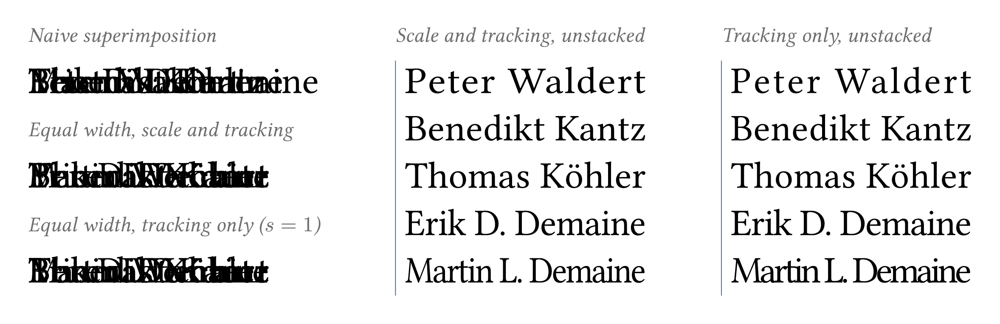

# Truly Every Author is First Author

<picture>
  <source media="(prefers-color-scheme: dark)" srcset="demo/teaser-dark.png">
  
</picture>

[](https://doi.org/10.48550/arXiv.2611.01331)

An original work by Demaine & Demaine ([arXiv:2304.01393](https://arxiv.org/abs/2304.01393)) proposed that every author be a first author by printing all names on top of each other. But names have different widths, so the longest name still dominates the block, and a short name hides inside a long one. That brings the ranking back.

This repo fixes that. Each name is stretched or squeezed, using a horizontal glyph scale `s` and a letter tracking `t`, until all names have one common width `W*`. The distortion is chosen to be as small as possible:

- for a fixed width, the best `(s, t)` for each name has a closed form (Lagrange multipliers);
- the best common width `W*` is a weighted mean of the natural widths.

It ships as a LaTeX package, a Typst package, a paper, and a Lean proof of every proposition in the paper.

**Read the paper here**: [arXiv:2611.01331](https://arxiv.org/abs/2611.01331).

Example in LaTeX (more in `demo/demo.tex`):

```latex
\documentclass{article}
\usepackage[backend=biber, style=numeric]{biblatex}
\addbibresource{sources.bib}
\usepackage{equalauthors}

\equalauthorsSetup{alpha=1, beta=1}
\equalauthorsAddAuthor{Leonhard Euler}
\equalauthorsAddAuthor{Emmy Noether}
\equalauthorsAddAuthor{David Chillbert}

\title{A Paper With All First Authors}
\author{\equalauthorsAuthors}
\date{}

\begin{document}
  \maketitle

  All three names above are superimposed and all are
  \equalauthorsWidth\,pt wide.

  The standard applies to reference lists too, for example~\cite{demaine2023every}.
  (The automatic biblatex implementation is new!)

  \printbibliography
\end{document}
```

Example in Typst (more in `demo/paper.typ`):

```typst
#import "lib/equalauthors.typ": *

#show: equal-references  // superimpose the authors in the references
#set page(paper: "a4", margin: 2.5cm)
#set par(justify: true)
#set heading(numbering: "1.")

#let authors = (
  "Leonhard Euler",
  "Emmy Noether",
  "David Chillbert",
)

#align(center)[
  #text(17pt, weight: "bold")[A Paper With All First Authors]
  #v(1em)
  #text(12pt, eqa-authors(authors))
  #v(0.5em)
  #text(10pt, datetime.today().display())
]

#v(1em)

= Introduction

The superimposition standard @demaine2023every removes author order but leaves
author width, which the reader still reads as a ranking. Equalising the widths
closes that gap.

= Citations

The standard applies to references and bibliographies too, @demaine2023every, for instance:

#bibliography("sources.bib", style: "lib/equalauthors.csl")
```

## Layout

| Path                     | What                                                                                                   |
| ------------------------ | ------------------------------------------------------------------------------------------------------ |
| `lib/equalauthors.sty`   | LaTeX package (pdfLaTeX or LuaLaTeX; needs `microtype`)                                                |
| `lib/equalauthors.typ`   | Typst package                                                                                          |
| `lib/equalauthors.csl`   | Citation style that lets Typst superimpose bibliography authors                                        |
| `demo/`                  | Small LaTeX and Typst examples, a Typst self-check, and `teaser.typ` (the image above, light and dark) |
| `paper/`                 | The paper (`main.tex`) and an arXiv packaging script                                                   |
| `lean/EqualAuthors.lean` | Lean 4 + Mathlib formalisation                                                                         |

## LaTeX

```latex
\usepackage{equalauthors}            % put lib/ on the TeX path

\equalauthorsAddAuthor{Erik D. Demaine}
\equalauthorsAddAuthor{Martin L. Demaine}
\author{\equalauthorsAuthors}
```

| Command                       | Does                                    |
| ----------------------------- | --------------------------------------- |
| `\equalauthorsAuthors`        | All authors superimposed                |
| `\equalauthorsAuthorsStacked` | Same widths, one per line, for checking |
| `\equalauthorsList{A and B}`  | Superimpose a BibTeX-style name list    |
| `\equalauthorsWidth`          | The common width `W*` in pt             |
| `\equalauthorsSolution{Name}` | One name's `w & s & t`, as table cells  |
| `\equalauthorsSetup{...}`     | Set options (below)                     |
| `\equalauthorsClear`          | Empty the author list                   |

With biblatex, cited authors are superimposed automatically, in the bibliography and in `\citeauthor`, from a plain `.bib` file. Author lists are never cut to "et al.".

```latex
\usepackage{equalauthors}
\usepackage[backend=biber]{biblatex}
\addbibresource{sources.bib}
```

With plain BibTeX, wrap the `.bib` author field in an extra pair of braces instead:

```bibtex
author = {{\equalauthorsList{Erik D. Demaine and Martin L. Demaine}}}
```

See `demo/demo.tex`. It compiles from `demo/` or from the repo root, so it also works on Overleaf.

## Typst

```typst
#import "lib/equalauthors.typ": *

#eqa-authors(("Erik D. Demaine", "Martin L. Demaine"))
```

| Function                             | Does                                                                         |
| ------------------------------------ | ---------------------------------------------------------------------------- |
| `eqa-authors(names, ..opts)`         | All names superimposed                                                       |
| `eqa-authors-stacked(names, ..opts)` | Same widths, one per line, with a rule on the left (`rule:` sets its colour) |
| `eqa-list("A and B", ..opts)`        | Superimpose a BibTeX-style name list                                         |
| `optimal-width(names, ..opts)`       | `W*` (needs `context`)                                                       |
| `solve(name, W, ..opts)`             | One name's `(s, t)`                                                          |
| `equal-references`                   | Show rule that superimposes bibliography authors                             |

For the bibliography, use the bundled citation style:

```typst
#show: equal-references
#bibliography("sources.bib", style: "lib/equalauthors.csl")
```

Run the examples from the repo root:

```sh
typst compile --root . demo/paper.typ
typst compile --root . demo/check.typ   # fails if any name misses W*
```

## Options

Both packages take the same options.

| Option         | Default        | Meaning                                           |
| -------------- | -------------- | ------------------------------------------------- |
| `alpha`        | `1`            | Cost of glyph scaling. Higher means less scaling. |
| `beta`         | `1`            | Cost of tracking. Higher means less tracking.     |
| `smin`, `smax` | `0.85`, `1.15` | Bounds on the scale `s`                           |
| `fix_t`        | `false`        | Scale only, no tracking                           |
| `fix_s`        | `false`        | Track only, no scaling (`s = 1`)                  |

## Proofs

```sh
lake exe cache get         # Mathlib build cache
lake build
```

Each theorem is named after its label in the paper (`prop_split`, `prop_width`, `eq_clamp`, `eq_problem`, `abl_scale`, ...). Lean `v4.33.1`.

## Citation

```bibtex
@misc{2026-truly-every-author-is-first-author,
  author        = {Peter Waldert and Benedikt Kantz and Thomas K{\"o}hler},
  title         = {Truly Every Author is First Author: Equal-Width Superimposition by Minimising Visual Distortion},
  year          = {2026},
  eprint        = {2611.01331},
  archiveprefix = {arXiv},
  primaryclass  = {cs.DL},
  doi           = {10.48550/arXiv.2611.01331}
}
```

## License

MIT, see [LICENSE](LICENSE).
